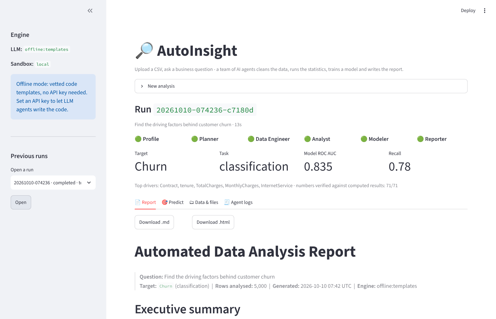
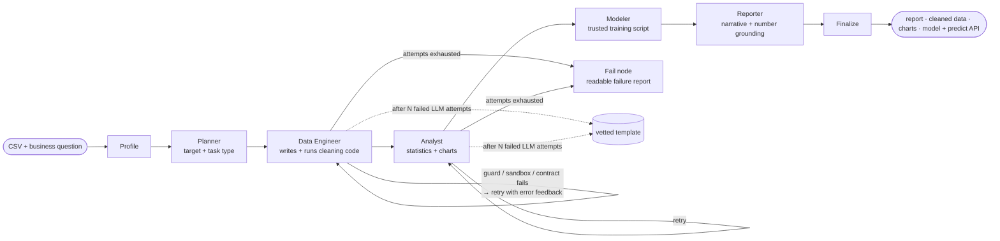
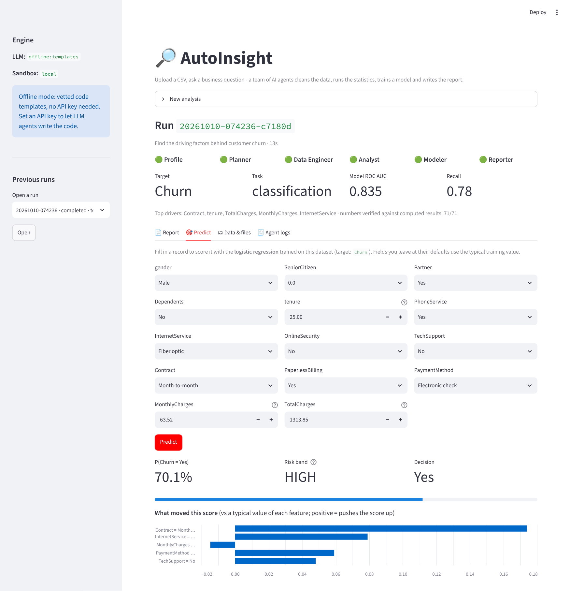

# 🔎 AutoInsight — a multi-agent system for automated data analysis

[](https://github.com/tarubee19/autoinsight/actions/workflows/ci.yml)


Upload a raw CSV, ask a business question — *"Find the driving factors behind customer churn"* — and a team of
AI agents **cleans the data, runs the statistics, trains a model, and writes a business report whose numbers are
verified against the computed results.** The trained model is then served through a **prediction API and UI** with
per-prediction explanations.

Built with **LangGraph**, **Claude / GPT** (pluggable), a **hardened Docker sandbox** for model-written code,
**FastAPI**, **Streamlit** and **scikit-learn**. Runs **fully offline with no API key** (vetted code templates), so
anyone can clone it and see it work in two minutes.



---

## Table of contents

1. [What it does](#what-it-does)
2. [Architecture](#architecture)
3. [Quickstart (2 minutes, no API key)](#quickstart-2-minutes-no-api-key)
4. [Using a real LLM (Claude or GPT)](#using-a-real-llm-claude-or-gpt)
5. [The interfaces: CLI, REST API, web UI](#the-interfaces-cli-rest-api-web-ui)
6. [Example output](#example-output)
7. [Evaluation](#evaluation)
8. [Why it is built this way (design decisions)](#why-it-is-built-this-way-design-decisions)
9. [Security model](#security-model)
10. [Docker and deployment](#docker-and-deployment)
11. [Project structure](#project-structure)
12. [Development: tests, lint, CI](#development-tests-lint-ci)
13. [Honest status and limitations](#honest-status-and-limitations)
14. [Publish this on GitHub](#publish-this-on-github)
15. [Documentation index](#documentation-index)

---

## What it does

| Stage | Agent | What happens |
|---|---|---|
| 1 | **Profile** (deterministic) | Reads the CSV robustly (encodings, delimiters, BOM), profiles every column: types, missingness, cardinality, ID-like and constant columns. |
| 2 | **Planner** | Decides the **target column** and task type (classification / regression) from your question + the profile. Its plan is *validated against the real schema* — it cannot invent a column. |
| 3 | **Data Engineer** | Writes and executes Python to clean the data: de-duplicate, fix numbers stored as text, impute missing values, clip outliers, drop IDs/constants. Every step is logged. |
| 4 | **Analyst** | Writes and executes Python for the statistics (Mann-Whitney / Welch + Cohen's d, χ² + Cramér's V, Spearman, Kruskal-Wallis, Benjamini-Hochberg multiple-testing correction) and the Matplotlib charts. |
| 5 | **Modeler** (trusted script) | Cross-validated model selection (baseline vs. regularised linear vs. gradient boosting), held-out evaluation, permutation importance, leakage scan, calibration, lift, and a saved model + schema for the prediction API. |
| 6 | **Reporter** | Writes the markdown business report from a compact facts file (it never sees raw data). Its numbers are **checked against the computed results**: if fewer than 90% trace back, it gets one correction attempt, then a deterministic writer takes over. The verified rate is printed in the report. |

Outputs of one run: `report.md` / `report.html` (charts inlined), `cleaned.csv`, `cleaning_log.json`, `stats.json`,
`metrics.json`, `feature_importance.json`, `charts/*.png`, `model.joblib`, `schema.json`, and a full log of every
program the agents wrote — including the failed attempts that were repaired.

**Robustness is the point.** LLM-written code fails in practice. This project is designed around that fact:
unsafe code is blocked *before* it runs, runtime errors and bad outputs are fed back to the agent for self-repair,
and if the LLM keeps failing the system degrades to a vetted template instead of crashing. See
[Evaluation](#evaluation) for the fault-injection results.

## Architecture



Each code-writing agent runs **the same four-gate loop** (`agents/code_agent.py`):

```text
LLM writes code → ① AST safety guard → ② sandbox execution → ③ output-contract validation → accepted
        ▲                  │ rejected          │ crash / timeout        │ wrong / missing outputs
        └──────────────────┴───────────────────┴────────────────────────┘  error text fed back, retry
```

More detail in **[docs/ARCHITECTURE.md](docs/ARCHITECTURE.md)**.

## Quickstart (2 minutes, no API key)

Requires **Python 3.12 or 3.13**.

```bash
git clone https://github.com/tarubee19/autoinsight.git
cd autoinsight

python -m venv .venv
source .venv/bin/activate            # Windows (PowerShell):  .venv\Scripts\Activate.ps1

pip install -c constraints.txt -e ".[all]"

autoinsight doctor                   # environment check
autoinsight run data/sample/telco_churn.csv -q "Find the driving factors behind customer churn"
```

You will see the agents work, then:

```text
AutoInsight - provider=offline  sandbox=auto
  [+] profile   profiled 5,040 rows x 17 columns
  [+] planner   planner: target 'Churn' (classification), source=heuristic
  [+] engineer  engineer finished (attempt 1, offline-template, 1.5s)
  [+] analyst   analyst finished (attempt 1, offline-template, 3.3s)
  [+] modeler   modeler trained logistic regression (AUC 0.835, 7.3s)
  [+] reporter  reporter wrote the report (offline-writer; 71/71 numbers verified)
  [+] finalize  run completed

Done in 12.7s  ->  runs/20261010-080334-67ea98
```

Open `runs/<run-id>/artifacts/report.html` in a browser. Now start the web app (two terminals):

```bash
autoinsight serve                           # terminal 1 — REST API  → http://localhost:8000/docs
streamlit run app/streamlit_app.py          # terminal 2 — UI        → http://localhost:8501
```

Use your own data: **Upload CSV** in the UI, or `autoinsight run my_data.csv -q "What drives X?"` (add
`-t ColumnName` to name the target yourself).

> **Offline mode** uses vetted, tested code templates in place of LLM-written code. The statistics, model, charts,
> report, API and UI are all real — only "who wrote the Python" differs. With an API key the agents write the code
> themselves, and everything is held to the same safety gates.

## Using a real LLM (Claude or GPT)

```bash
cp .env.example .env                 # then edit: ANTHROPIC_API_KEY=...  (or OPENAI_API_KEY=...)
set -a; source .env; set +a          # load it into your shell

# LLM-written code only runs in the Docker sandbox. Build it once:
docker build -f docker/Dockerfile.sandbox -t autoinsight-sandbox:latest .

autoinsight doctor                   # should now show: LLM provider anthropic, Sandbox image ready
autoinsight run data/sample/telco_churn.csv -q "Find the driving factors behind customer churn"
```

* `AUTOINSIGHT_LLM_PROVIDER=auto` picks Anthropic if its key is set, else OpenAI, else offline. Force one with
  `--provider anthropic|openai|offline`; override the model with `AUTOINSIGHT_MODEL=<model name>`.
* **Safety rule:** model-written code is refused unless the Docker sandbox is available. There is an explicit
  opt-in (`AUTOINSIGHT_ALLOW_UNSAFE_LOCAL=1`) for experiments on a throw-away machine — do not use it with untrusted
  CSVs or on a server.
* Privacy: by default 3 example values per column are sent to the LLM to help it write correct code. Set
  `AUTOINSIGHT_SEND_SAMPLE_VALUES=0` to send only column names, types and aggregate statistics.
* Run `python scripts/evaluate.py --real-llm` to benchmark your LLM on the three sample datasets
  (writes `docs/EVALUATION_LLM.md`).

## The interfaces: CLI, REST API, web UI

### CLI

```bash
autoinsight run data/sample/house_prices.csv -q "What drives the sale price of a house?"
autoinsight predict <run-id> --json '{"sqft": 2100, "bathrooms": 2, "neighborhood": "Harbor"}'
autoinsight serve --port 8000
autoinsight doctor
```

### REST API (FastAPI, interactive docs at `/docs`)

| Method & path | Purpose |
|---|---|
| `GET /health` | Engine status (LLM provider, sandbox mode) |
| `GET /samples` | Bundled sample datasets |
| `POST /jobs` | Start an analysis (multipart: `file` **or** `sample`, plus `question`, optional `target`) → `202 {job_id}` |
| `GET /jobs`, `GET /jobs/{id}` | List runs; status, per-stage progress, live agent events, summary |
| `GET /jobs/{id}/report` | Report as markdown (or `?format=html`) |
| `GET /jobs/{id}/artifacts[/{path}]` | List / download any output (cleaned CSV, charts, model…) |
| `GET /jobs/{id}/logs` | Every program the agents wrote and ran, with errors and retries |
| `GET /jobs/{id}/schema` | Input schema of the trained model (types, ranges, categories, defaults) |
| `POST /jobs/{id}/predict` | **Score records** with the model trained on *your* data |
| `DELETE /jobs/{id}` | Delete a run and its data |

```bash
# 1. start an analysis
curl -s -X POST localhost:8000/jobs \
  -F sample=telco_churn -F "question=Find the driving factors behind customer churn"
# {"job_id":"20261010-074236-c7180d","status":"queued"}

# 2. poll until "status": "completed"
curl -s localhost:8000/jobs/20261010-074236-c7180d

# 3. predict — only send the fields you know; the rest default to typical training values
curl -s -X POST localhost:8000/jobs/20261010-074236-c7180d/predict \
  -H 'Content-Type: application/json' \
  -d '{"record": {"Contract": "Month-to-month", "tenure": 3, "MonthlyCharges": 95.5,
                  "InternetService": "Fiber optic", "TechSupport": "No"}, "explain": true}'
```

```json
{
  "task_type": "classification", "target": "Churn", "model": "logistic regression",
  "predictions": [{
    "probability": 0.8519, "label": "Yes", "risk_band": "high",
    "threshold": 0.3034, "base_rate": 0.2926,
    "top_factors": [
      {"feature": "Contract",        "value": "Month-to-month", "effect": 0.1612},
      {"feature": "tenure",          "value": 3.0,              "effect": 0.0683},
      {"feature": "InternetService", "value": "Fiber optic",    "effect": 0.0562}
    ],
    "warnings": {"defaulted_fields": ["gender", "SeniorCitizen", "Partner", "..."]}
  }]
}
```

`top_factors` is a one-feature "what-if" explanation: how much the probability changes when that feature is
replaced by its typical training value. Inputs are validated — unseen categories and out-of-range values produce
`warnings`, not silent garbage.

Protect a deployed API with `AUTOINSIGHT_API_KEY=...` (clients send `X-API-Key`). Uploads are size-limited, run ids are
validated against path traversal, and old runs can be auto-deleted (`AUTOINSIGHT_RETENTION_HOURS`).

### Web UI (Streamlit)

Upload a CSV or pick a sample → live stage tracker and agent log → report → a **Predict** tab with a form generated
from the model's schema, a risk gauge and an explanation chart → data/file downloads → full agent logs.



## Example output

Real output of `autoinsight run` on the bundled synthetic churn dataset — see the full
[`examples/telco_churn/report.md`](examples/telco_churn/report.md) (and the HTML version with inlined charts).

```markdown
## Executive summary
- Across 5,000 analysed rows, 29.3% have **Churn = Yes**.
- The strongest statistically significant drivers are **Contract** (medium association, strength 0.45),
  **tenure** (medium association, strength 0.41), **TotalCharges** (small association, strength 0.27).
- Contract: 'Month-to-month' has the highest Churn rate (47.4%, n=2788) vs 'Two year' at 3.9% (n=1206).
- A logistic regression model separates the outcome on unseen data with ROC AUC 0.83; the highest-scored 10%
  of rows contain 26% of all positives (2.6x lift over random selection).
- These are statistical associations in observational data, not proof of cause and effect.
```

| Strength of association | Model feature importance |
|---|---|
|  |  |

The report also contains data-quality notes, recommendations, limitations, and appendices (cleaning log, full
statistics table, methodology, model details). Also included: a regression example
([`examples/house_prices/`](examples/house_prices/report.md)) and a
**[trace of the workflow repairing itself](examples/self_repair_trace.md)** after the "LLM" wrote unsafe code, then
buggy code.

## Evaluation

Reproduce with `python scripts/evaluate.py` (offline, ~2 min; full results in
[docs/EVALUATION.md](docs/EVALUATION.md)).

**1. Driver recovery on data with planted ground truth.** Each synthetic dataset is generated from a known process
and then deliberately corrupted (duplicates, numbers-as-text, blanks, constant/ID columns, outliers, missing values).
*Precision@k* = share of the k planted drivers found in the top k ranked features.

| Dataset | Rows × cols | Task | Held-out score | Stats P@k | Model P@k | Report numbers verified |
|---|---|---|---|---|---|---|
| `telco_churn` | 5,040 × 17 | classification | ROC AUC 0.835 | 83% (k=6) | 100% | 71 / 71 |
| `hr_attrition` | 1,500 × 13 | classification | ROC AUC 0.737 | 80% (k=5) | 100% | 68 / 68 |
| `house_prices` | 2,000 × 9 | regression | R² 0.934 | 100% (k=5) | 100% | 37 / 37 |

**2. Fault injection** — a scripted "LLM" misbehaves; did the run still finish with a correct report?

| Injected fault | Recovered |
|---|---|
| Data Engineer writes unsafe code (`os.system`) | ✅ blocked before execution, repaired on attempt 2 |
| Runtime error (`KeyError` on a made-up column) | ✅ error fed back, repaired on attempt 2 |
| Program runs but writes no output file | ✅ caught by the output contract, repaired |
| Analyst names a feature that does not exist | ✅ rejected by the contract, repaired |
| Reporter invents statistics (87.65%, 42.1%) | ✅ grounding check rejects the narrative, deterministic report used |
| Every LLM call fails (API outage) | ✅ degrades to vetted templates + deterministic report |
| LLM never writes working code | ✅ falls back to vetted templates after the attempt budget |

> **How to read this honestly.** The datasets are synthetic and the planted effects are fairly strong, so these
> numbers show that *the pipeline works* (cleaning doesn't destroy signal, tests are sensible, rankings are sane) —
> not that it finds insight on every real dataset. Try it on the public IBM Telco churn dataset or your own data.

## Why it is built this way (design decisions)

* **Defence in depth for LLM-written code.** An AST allow-list rejects dangerous code *before* it runs; a Docker
  sandbox (no network, read-only FS, non-root, all capabilities dropped, memory/CPU/PID limits) contains whatever gets
  through; output validators reject results that are structurally wrong. The AST guard is a *pre-filter*, not the
  security boundary — the sandbox is. ([docs/SECURITY.md](docs/SECURITY.md))
* **Self-repair as a graph cycle.** In LangGraph, `engineer` and `analyst` loop back to themselves with the previous
  error in the prompt. The retry budget is explicit, and when it is spent the workflow *degrades gracefully* to a
  vetted template rather than failing.
* **The model is trained by a trusted script, not by LLM-written code.** Model selection, thresholding and
  leakage checks are too important to leave to free-form generation, and the saved artifact has to be loadable by the
  prediction API.
* **Reports are checked for invented numbers.** Every figure in the narrative (except years and small integers
  such as "top 3" or "5-fold") is matched, rounding-aware, against the computed facts (`grounding.py`). A narrative
  with fewer than 90% traceable numbers gets one repair attempt, then a deterministic writer takes over; the final
  verified rate is shown in the report. This is a *numeric trace*, not a semantic check — see the limitations.
* **Statistics done properly.** Non-parametric tests where assumptions fail, effect sizes next to p-values,
  Benjamini-Hochberg correction across many features, a unified 0–1 strength scale so numeric and categorical drivers
  are comparable, and an explicit "association ≠ causation" caveat in every report.
* **Works with no API key.** Offline mode makes the project demoable, testable in CI, and deployable publicly
  without exposing an LLM key or running untrusted code.

## Security model

Short version — see **[docs/SECURITY.md](docs/SECURITY.md)** for the threat model:

| Layer | Protects against |
|---|---|
| AST code guard (allow-listed imports; no `eval/exec/open`, dunders, URLs, absolute paths) | The obvious: model-written code that shells out, reads files, or phones home |
| Docker sandbox: `--network none --read-only --cap-drop ALL --user 65534`, memory/CPU/PID/time limits, input mounted read-only | Anything the guard misses; resource exhaustion |
| Output-contract validators | Wrong or missing results, hallucinated features |
| Refusal to run LLM code outside Docker (unless explicitly overridden) | Misconfiguration on a laptop or server |
| API: optional API key, upload size limit, run-id validation, retention | Abuse of a public deployment |

**Public deployments must stay in offline mode** (vetted templates only). Running LLM-written code for strangers
needs a stronger isolation boundary than a Docker socket (gVisor, Firecracker, a dedicated sandbox service).

## Docker and deployment

```bash
# API + UI in containers, offline mode            →  UI :8501   API docs :8000/docs
docker compose up --build

# Real LLM + hardened Docker sandbox (your own machine only; mounts the Docker socket — read the warning in the file)
cp .env.example .env     # add your API key
docker compose -f docker-compose.yml -f docker-compose.llm.yml up --build
```

Free public demo options (all use `docker/Dockerfile.demo`, one container, offline mode): **Hugging Face Spaces**
(`deploy/hf-space/`), Render, Railway, Fly.io. Step-by-step instructions, including the Docker-socket caveats and
`AUTOINSIGHT_HOST_RUNS_DIR`, are in **[docs/DEPLOYMENT.md](docs/DEPLOYMENT.md)**.

## Project structure

```text
autoinsight/
├── src/autoinsight/
│   ├── graph.py            LangGraph workflow (nodes, conditional edges, retry cycles)
│   ├── pipeline.py         run_pipeline(): one entry point for CLI, API and tests
│   ├── agents/             planner · engineer · analyst · modeler · reporter · code_agent (shared loop) · contracts
│   ├── llm.py              Anthropic / OpenAI / Offline clients behind one Protocol
│   ├── code_guard.py       AST safety checks for model-written code
│   ├── sandbox.py          Docker sandbox (+ guarded local fallback)
│   ├── scripts/            programs that run INSIDE the sandbox: runner, vetted templates, model trainer
│   ├── profiling.py        CSV loading, profiling, target detection, heuristic plan
│   ├── grounding.py        verifies every number in the report against computed facts
│   ├── reporting.py        facts + markdown/HTML report assembly
│   ├── predictor.py        validated predictions + explanations
│   ├── api.py · jobs.py    FastAPI app and background job manager
│   └── cli.py              autoinsight run | serve | predict | doctor
├── app/streamlit_app.py    web UI
├── data/                   synthetic dataset generator (planted drivers) + 3 sample CSVs
├── tests/                  100+ tests: guard, sandbox, output trust, grounding, pipeline, self-repair, API, robustness
├── scripts/                evaluate.py (benchmark) · make_examples.py
├── examples/               committed real outputs (reports, charts, self-repair trace)
├── docker/ · docker-compose*.yml · deploy/hf-space/ · .github/workflows/ci.yml
└── docs/                   ARCHITECTURE · SECURITY · DEPLOYMENT · EVALUATION · CV_AND_INTERVIEW
```

## Development: tests, lint, CI

```bash
make install     # pip install -c constraints.txt -e ".[all]"
make lint        # ruff
make test        # pytest  (~5 min: includes complete pipeline runs)
make eval        # regenerate docs/EVALUATION.md
```

`pytest -m "not docker"` runs everything that does not need a Docker daemon. GitHub Actions (`.github/workflows/ci.yml`)
runs lint + tests on Python 3.12/3.13, then builds all images, runs the Docker-backend sandbox tests (network
isolation, hardening flags), an end-to-end run with the Docker sandbox, and a `docker compose` smoke test.

## Honest status and limitations

What has been **run and verified**: the complete workflow on all three datasets (offline), the self-repair and
fault-injection scenarios, the REST API (including predict), the CLI, the Streamlit UI, the single-container demo
script, lint, and the test suite (101 passed, 1 Docker-only test skipped) on Python 3.13, plus a clean-room install, a CLI run and the earlier test suite on Python 3.12.

What has **not been run by the author of this repo** — verify these yourself before claiming them:

* **Docker-backed execution** (sandbox image build, `docker compose`, the Docker-backend tests). The commands and
  configuration are validated and the CI workflow exercises them, but the machine this was developed on had no Docker
  daemon. Push to GitHub and check that CI is green; run `pytest -m docker` locally if you have Docker.
* **Live LLM runs.** The Anthropic/OpenAI clients are implemented, but all LLM behaviour was tested with a scripted
  stand-in (which is what makes the fault-injection results reproducible). Run `python scripts/evaluate.py --real-llm`
  with your key and publish *your* results.
* **Real-world data.** Sample datasets are synthetic. Try a public dataset (IBM Telco churn, Kaggle HR attrition…).

Known limitations: the number-grounding check proves a figure *exists in the computed results* (and the rate is
shown in the report), not that the sentence around it is correct — a real number attached to the wrong claim would
pass; a single random train/test split (use a time-based split for time-dependent data); explanations
are one-feature what-ifs, not SHAP; association is not causation; CSV only, in-memory processing (practical limit
~50 MB by default); background jobs use a local thread pool and filesystem state — fine for a demo, replace with a
queue (Celery/RQ) and object storage for real multi-user scale; no authentication beyond an optional API key.

## Publish this on GitHub

1. **Fill in the two placeholders** (Hub username and your name — used in badges, clone URLs, deploy files and the licence).
   One command, works on Windows, macOS and Linux:
   ```bash
   python scripts/personalize.py --github-user your-github-name --name "Your Full Name"
   python scripts/personalize.py --check        # should print: No placeholders left.
   ```
2. Create the repository and push:
   ```bash
   git init -b main
   git add .
   git commit -m "AutoInsight: multi-agent automated data analysis"
   # Option A — GitHub CLI
   gh repo create autoinsight --public --source=. --push
   # Option B — create an empty repo on github.com, then:
   git remote add origin https://github.com/your-github-name/autoinsight.git
   git push -u origin main
   ```
3. Open the **Actions** tab and wait for CI. Fix anything red *before* you put the link on your CV.
4. Add repository topics: `langgraph`, `multi-agent`, `llm`, `data-analysis`, `fastapi`, `streamlit`, `docker`, `mlops`.
5. Deploy the live demo ([docs/DEPLOYMENT.md](docs/DEPLOYMENT.md)) and add its URL to the top of this README.
6. Write your CV bullets and prepare for interviews with [docs/CV_AND_INTERVIEW.md](docs/CV_AND_INTERVIEW.md).

## Documentation index

| Doc | Contents |
|---|---|
| [docs/ARCHITECTURE.md](docs/ARCHITECTURE.md) | Graph, state, agent contracts, the four-gate code loop, modeling and reporting internals |
| [docs/SECURITY.md](docs/SECURITY.md) | Threat model, each defensive layer, what is *not* protected, hardening checklist |
| [docs/DEPLOYMENT.md](docs/DEPLOYMENT.md) | Docker Compose, Hugging Face Space, Render/Railway, VPS, environment variables |
| [docs/EVALUATION.md](docs/EVALUATION.md) | Benchmark methodology and results |
| [docs/CV_AND_INTERVIEW.md](docs/CV_AND_INTERVIEW.md) | CV bullets, 60-second pitch, interview Q&A, honest-claims checklist |

## License

MIT — see [LICENSE](LICENSE).
