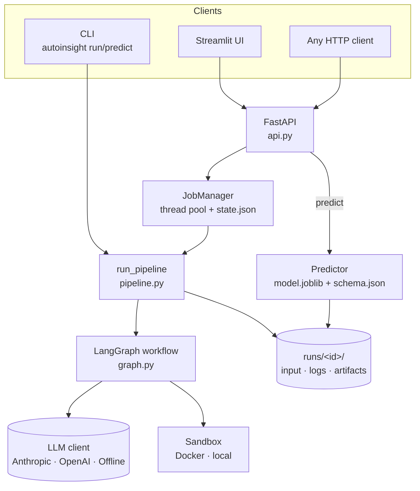
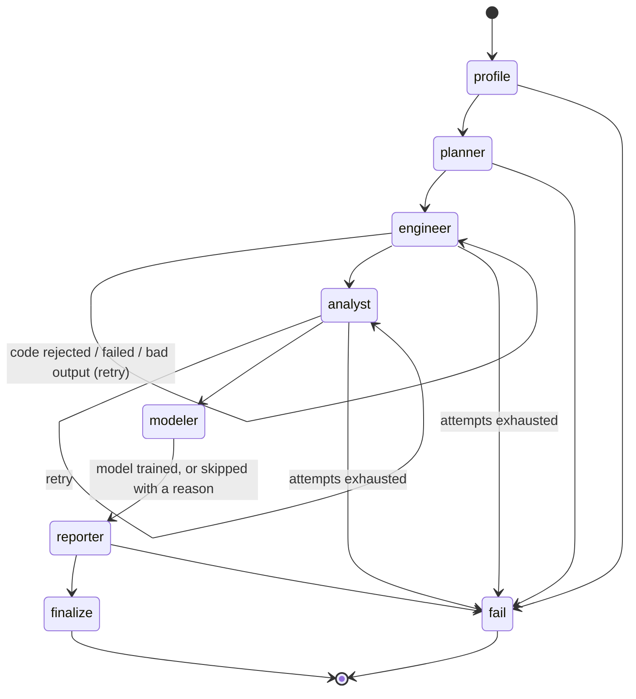

# Architecture

## 1. The big picture



* **One entry point.** `pipeline.run_pipeline(csv, question, target, settings, llm, sandbox, on_event)` is used by
  the CLI, the API's job manager, the tests and the evaluation script. It canonicalises the upload to
  `input.csv` (encoding/delimiter/BOM normalised once), builds the graph, runs it, and writes `state.json` atomically.
* **State vs. context.** `AgentState` (a `TypedDict`) is the serialisable data that flows through the graph
  (question, profile, plan, per-agent status, facts, errors; `events` is an `Annotated[list, operator.add]` reducer so
  every node appends to the log). `RunContext` holds the non-serialisable things a node needs — settings, LLM client,
  sandbox, run directory, event emitter — and is passed through LangGraph's `config["configurable"]`.
* **Everything is a file.** A run is a directory (`input.csv`, `state.json`, `logs/`, `artifacts/`, `work/`). This makes
  runs inspectable, portable, deletable, and lets the API stay stateless apart from the filesystem.

## 2. The workflow graph (`graph.py`)



Routing is one small function (`_after`): an `error` in state → `fail`; a `retry` status on a retryable node → the
**same node again** (a real graph cycle, not a Python `for` loop hidden in a node); otherwise → the next node.
`fail` still writes a readable failure report and `state.json`, so a failed run is diagnosable from the UI.

| Node | LLM involved? | What it does | Output |
|---|---|---|---|
| `profile` | no | Loads the CSV, normalises missing-value tokens, profiles columns | `profile` |
| `planner` | yes (optional) | Proposes target + task type + columns to exclude. The proposal is **validated against the real schema** (`normalise_plan`); an invalid plan gets one retry with the error, then the deterministic heuristic plan is used. An explicit target from the user that cannot be used fails the run — it is the user's input to fix | `plan` (`source`: user / llm / heuristic) |
| `engineer` | yes — writes code | Cleaning program | `cleaned.csv`, `cleaning_log.json` |
| `analyst` | yes — writes code | Statistics + charts | `stats.json`, `charts/*.png` |
| `modeler` | **no** — trusted script | Model selection, evaluation, explanations | `model.joblib`, `metrics.json`, `feature_importance.json`, `schema.json`, model charts |
| `reporter` | yes — writes prose | Narrative from a facts file; number-checked | `report.md`, `report.html`, `facts.json`, `grounding.json` |
| `finalize` / `fail` | no | Write the run summary | `state.json` summary |

## 3. The four-gate loop for code-writing agents (`agents/code_agent.py`)

`run_code_agent_step` performs **one attempt**; the graph decides what happens next.

```text
1. get code      LLM prompt (task + schema + plan + the previous program and its error, if any)
                 └ or, after the attempt budget is spent, the vetted template
2. guard         code_guard.check_code(): AST allow-list           → violation text → error
3. sandbox       Sandbox.run(): isolated execution + timeout       → traceback (filtered, with line numbers) → error
4. contract      validate_engineer / validate_analyst              → list of problems → error
5. promote       copy ONLY allow-listed output files into artifacts/  (see SECURITY.md)
```

* `error is None` → status `ok`, graph continues. Otherwise status `retry` and the **error text becomes part of the next
  prompt** ("YOUR PREVIOUS PROGRAM FAILED …" + code + error).
* **Attempt budget:** `max_code_attempts` LLM attempts (default 3) → **one more attempt with the vetted template**
  (graceful degradation; the report records that a fallback was used) → `fail`. In offline mode there is only the
  template, so a failure there is final.
* Every attempt writes `logs/<agent>_attemptN.json` (+ `.py`) with the code, outcome, error, stdout, duration — the UI's
  *Agent logs* tab and `examples/self_repair_trace.md` are views of these files.

### Contracts (`agents/contracts.py`)
Code that *runs* can still be *wrong*. The validators check, for example: `cleaned.csv` exists and is readable; the target
survives and has no missing values; classification targets are integer 0/1 with both classes present; at least 30 rows
remain and not more than half were dropped; no missing values remain in features; ID/excluded columns are really gone;
`cleaning_log.json` has the required keys; `stats.json` has a non-empty `top_drivers` list whose entries carry
`feature`, `strength` (0–1) and `finding`, every named feature is a real column of the cleaned data, classification runs
include a numeric `base_rate`, and at least two non-empty charts were saved. Each failure becomes a sentence the agent can act on.

### In-sandbox runtime (`scripts/runner.py`)
The only code that executes inside the sandbox, besides the agent's own program. It exposes a tiny API to that program —
`INPUT_PATH`, `OUT_DIR`, `PARAMS` (the plan), `save_csv`, `save_json`, `save_fig`, `log` — applies resource limits,
and reformats tracebacks to show **only the agent's own lines** (so repair feedback is short and relevant). Names passed
to `save_*` are sanitised to a basename with the right suffix.

## 4. Data preparation and statistics (the vetted templates)

The templates are the offline-mode implementation *and* the fallback for LLM mode, and they define the quality bar the
LLM output is compared against.

* **Engineer template**: reads with `keep_default_na=False` plus an explicit missing-token list (so a category literally
  named "None" is not silently turned into NaN), de-duplicates, converts text columns that hold numbers (it strips
  `,`, `$`, `%` and whitespace before parsing, e.g. `"1,234.5"`), drops constant, all-missing, ID-like and
  outcome-derived ("leakage suspect") columns, turns date columns into features and drops free text, clips outliers to the
  0.5–99.5 percentile, imputes (median / mode; numeric columns that were ≥ 5% missing also get a `<col>__was_missing`
  indicator), encodes the target to 0/1, and logs every step with counts.
* **Analyst template**: binary target — numeric feature → Mann-Whitney U (plus the Welch t-test p-value, Cohen's d and the
  U-based AUC), categorical feature → χ² with Cramér's V and per-level rates; numeric target — numeric feature →
  Spearman, categorical feature → Kruskal-Wallis with the correlation ratio η. **Benjamini-Hochberg** FDR correction across
  all tests; every result is mapped to a common **0–1 strength** scale (Cohen's d is converted to a correlation-scale
  effect; Cramér's V, |ρ| and η are already on it) so numeric and categorical drivers can be ranked together; pairs of
  numeric features with |Spearman ρ| ≥ 0.8 are flagged so overlapping drivers are not double-counted.

## 5. The Modeler (`scripts/train_model.py`)

Not LLM-written, because evaluation mistakes (leakage, tuning on the test set) are exactly what free-form generation gets wrong.

1. 80/20 split (stratified for classification), seed fixed.
2. **Model selection by cross-validation on the training split only**: majority-class/mean baseline vs. regularised linear
   (logistic / ridge) vs. `HistGradientBoosting`. The baseline is reported so the lift over "do nothing" is visible.
3. The chosen model is evaluated **once** on the held-out 20%.
4. Classification threshold: maximises F1 on **out-of-fold training predictions** (never on the test set).
5. Metrics: ROC AUC, PR AUC, precision, recall, F1, top-decile lift and capture, calibration bins (classification);
   R², MAE, RMSE (regression).
6. **Permutation importance on raw columns** (on held-out data), so importances refer to the user's columns rather than
   one-hot columns.
7. **Leakage checks**: columns whose names look derived from the outcome are excluded earlier, at planning time
   (`leakage_suspects`); the trainer additionally warns (classification) when a single feature alone reaches AUC > 0.97,
   and for any task when the held-out score is > 0.99 (ROC AUC or R²). Warnings appear in the report.
8. Saves the fitted pipeline plus per-feature marginals (used for the local explanations) and `schema.json`
   (feature types, ranges, categories, defaults) — the contract the prediction API and UI are generated from.

The step may **fail softly**: the report is still written, says that no model was trained and why, and the Predict tab explains.

## 6. The Reporter and number grounding (`agents/reporter.py`, `grounding.py`)

1. `build_facts` condenses cleaning log, statistics and metrics into a compact facts document (the reporter never sees raw rows).
2. The LLM writes a narrative with six required sections; missing sections or low grounding trigger **one** repair attempt
   with explicit feedback.
3. `check_numbers` extracts every number from the narrative (skipping code spans, URLs, list numbering, years and small
   integers ≤ 12 such as "top 3") and looks for a matching value in the facts — rounding-aware, and `47.4%` matches a stored
   `0.474`. The narrative is accepted when at least **90%** of the checked numbers trace to facts.
4. Otherwise `offline.write_narrative(facts)` — a deterministic writer — produces the narrative.
5. `assemble_report` adds the metadata header, charts and four appendices (cleaning log, statistics table, methodology,
   model details), including the exact "numbers traced to computed results" rate.

**Limits of the check:** it verifies that a number *exists somewhere in the computed results*, not that the sentence it is
in is true (a real number attached to the wrong feature would pass), and small integers are not checked.

## 7. Prediction service (`predictor.py`, `api.py`)

* `Predictor.load(artifacts)` reads `model.joblib` + `schema.json`. `predict(records, explain=True)` validates each record
  against the schema: unknown fields are ignored (and reported), missing fields take the training default (and are
  reported), numeric values far outside the training range or unseen categories produce `warnings`.
* Classification output: probability, label at the tuned threshold, a risk band (`high` ≥ threshold, `medium` ≥ base rate,
  else `low`), threshold and base rate. Regression output: the predicted value.
* **Explanations** are one-feature what-ifs: for each feature, the change in the prediction when it is replaced by typical
  values drawn from the training marginals; the top factors are returned with signed effects.
* The API runs jobs in a `ThreadPoolExecutor` (2 workers); job state lives in `state.json`, written atomically, so a
  restart does not lose finished runs. This is intentionally simple — see "Scaling" below.

## 8. LLM abstraction (`llm.py`)

`LLMClient` is a `Protocol` with `complete(LLMRequest) -> str`, `is_offline`, `name`. Implementations: `AnthropicClient`,
`OpenAIClient`, `OfflineClient` (answers each role from vetted templates / deterministic writers). `build_llm(settings)`
chooses via `Settings.resolved_provider()`. `extract_code` / `extract_json` tolerate markdown fences and prose around the answer. Adding a provider means adding one class. `testing.ScriptedLLM` implements the same protocol with
per-role scripts, which is how failures are injected reproducibly.

## 9. Testing strategy

| Layer | Tests |
|---|---|
| Unit | AST guard (what is blocked / allowed), number grounding, CSV profiling + target detection, output sanitising + promotion |
| Component | Sandbox behaviour (timeouts, limits, tracebacks; Docker-specific tests are marked `docker`) |
| Workflow | Complete runs on the sample datasets; self-repair with scripted failures (unsafe code, runtime bug, no output, hallucinated feature, outage, invented statistics); fallbacks |
| Interface | FastAPI via `TestClient` (jobs, predict, auth, upload limits, path traversal), CLI |
| Robustness | Odd inputs: semicolon CSVs with a BOM, heavy missingness, target encodings, date and free-text columns, a leakage column, constant/all-missing columns, a literal "None" category, tiny files, unicode, regression with outliers and text numbers; multiclass and single-valued targets must fail with a helpful message |

## 10. Scaling and what to change for production

| Concern | Today | For real multi-user use |
|---|---|---|
| Job execution | in-process thread pool | task queue (Celery/RQ/Arq) + worker pool |
| State | local filesystem | object storage (S3/GCS) + a database for run metadata |
| Sandbox | local Docker on the same host | remote sandbox service / gVisor / Firecracker, per-job quotas |
| Auth | optional shared API key | OIDC/JWT, per-user run ownership, rate limits |
| Large files | pandas in memory, 50 MB cap | chunked profiling, DuckDB/Polars, sampling for the LLM stage |
| Observability | per-attempt JSON logs | OpenTelemetry traces per agent, token/cost accounting |

## 11. Extending

* **New agent** → write `agents/<name>.py` with `def <name>_node(state, config) -> dict`, add the node and its edges in
  `graph.py`, add its stage to `state.STAGES` (progress tracking in the API) and to `STAGE_LABELS` in the Streamlit UI. Reuse `run_code_agent_step` if it writes code.
* **New provider** → implement `LLMClient`, register in `build_llm`.
* **New statistic / chart** → edit `scripts/analyst_template.py`; keep `stats.json`'s documented keys so the contract and
  the reporter keep working; add a case to `tests/`.
