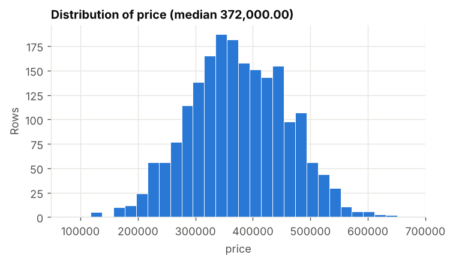
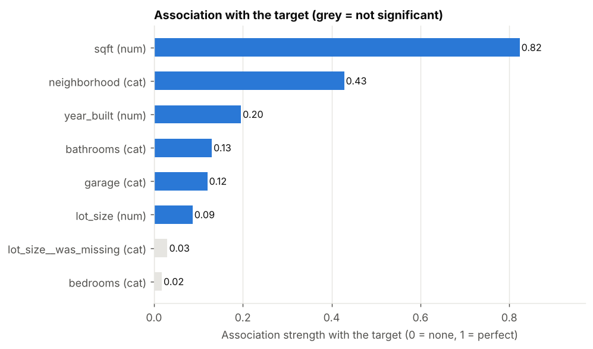
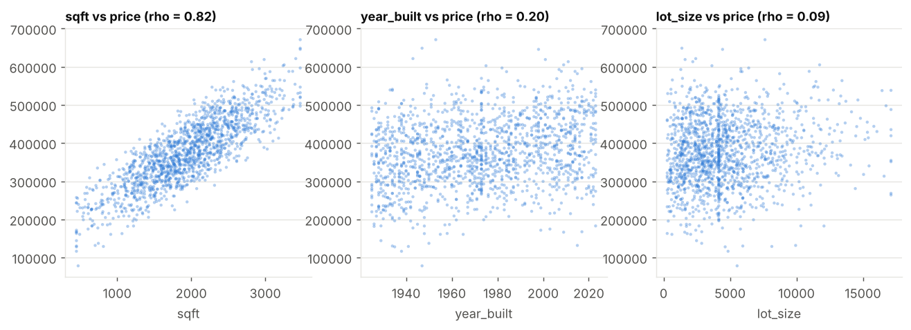
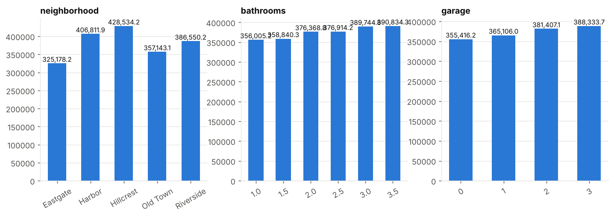
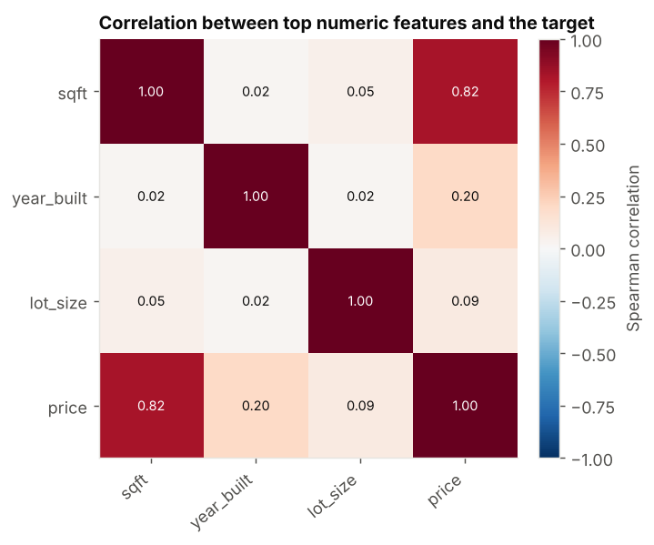
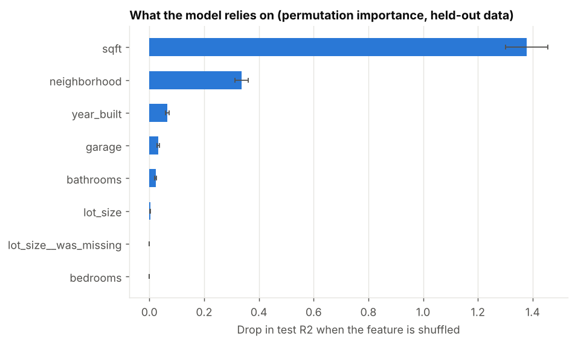
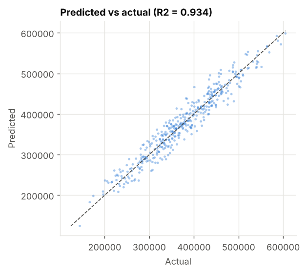

# Automated Data Analysis Report

> **Question:** What drives the sale price of a house?  
> **Target:** `price` (regression) &nbsp;|&nbsp; **Rows analysed:** 2,000 &nbsp;|&nbsp; **Generated:** 2026-10-10 08:13 UTC &nbsp;|&nbsp; **Engine:** offline:templates

## Executive summary
- Across 2,000 analysed rows, the median **price** is 372,000.00.
- The strongest statistically significant drivers are **sqft** (large association, strength 0.82), **neighborhood** (medium association, strength 0.43), **year_built** (small association, strength 0.20).
- sqft is positively related to price (Spearman rho = 0.82).
- A ridge regression model explains 93% of the variance on unseen data (R2 0.93, typical error 17,172.35).
- These are statistical associations in observational data, not proof of cause and effect.

## Data quality & preparation
- Started with 2,000 rows and 9 columns; kept 2,000 rows and 9 columns after cleaning.
- Dropped 1 columns that cannot carry signal: listing_id (identifier / excluded by the plan).
- Filled missing values in 2 columns using the median (numbers) or most common value (categories); most affected: lot_size (6.00% missing), year_built (2.00% missing).
- Clipped extreme values in sqft, lot_size to the 0.5-99.5 percentile range so entry errors cannot distort the results.

## What drives the outcome
Features are ranked by association strength (0 = none, 1 = perfect); significance is after Benjamini-Hochberg correction for testing many features.
1. **sqft** - strength 0.82 (large, significant). sqft is positively related to price (Spearman rho = 0.82).
2. **neighborhood** - strength 0.43 (medium, significant). neighborhood: 'Hillcrest' has the highest mean price (428534.22) vs 'Eastgate' (325178.18).
3. **year_built** - strength 0.20 (small, significant). year_built is positively related to price (Spearman rho = 0.20).
4. **bathrooms** - strength 0.13 (small, significant). bathrooms: '3.5' has the highest mean price (390834.34) vs '1.0' (356005.17).
5. **garage** - strength 0.12 (small, significant). garage: '3' has the highest mean price (388333.67) vs '0' (355416.24).
6. **lot_size** - strength 0.09 (negligible, significant). lot_size is positively related to price (Spearman rho = 0.09).

## Predictive model
- Three candidates were compared with 5-fold cross-validation on the training split (R2): baseline (mean) -0.00, ridge regression 0.93, gradient boosting 0.91. The best, **ridge regression**, was evaluated once on a held-out 20% test set.
- Test performance: R2 0.93, MAE 17,172.35, RMSE 21,642.90.
- What the model relies on most (permutation importance on held-out data): sqft, neighborhood, year_built, garage, bathrooms.

## Recommendations
1. Investigate why **sqft** separates the groups (it is higher for the positive class) and whether it can be influenced.
2. Use the model for estimates, and focus data-quality work on the features it relies on most.
3. Validate the top drivers with a controlled experiment before committing budget - these results show association, not causation.
4. Improve data capture for lot_size; more than 5% of values were missing.

## Limitations & next steps
- The target column **price** was inferred from your question; if that is not what you meant, run again with the target column set explicitly.
- Observational data: drivers are associations, and hidden confounders may explain part of them.
- Models were validated on a single random split; for time-dependent data use a time-based split before deploying.
- Missing values were imputed and extreme values clipped; both are logged in Appendix A and can change effect sizes slightly.
- Next steps: add domain features, test a time-based validation, and monitor drift after deployment.

## Charts

**Target distribution**

**Strength of association with the target**

**Top numeric drivers**

**Top categorical drivers**

**Correlation between top numeric features**

**What the model relies on**

**Predicted vs actual**

## Appendix A - Data cleaning log

| Step | What was done | Rows/cells/columns affected |
|---|---|---|
| drop_columns | Dropped columns that carry no usable signal | 1 |
| winsorise_outliers | Clipped extreme values to the 0.5-99.5 percentile range | 30 |
| impute_missing | Filled remaining missing values | 160 |

## Appendix B - Statistical tests (top 15 by strength)

| Feature | Type | Test | Strength (0-1) | Size | Adj. p-value | Significant |
|---|---|---|---|---|---|---|
| sqft | numeric | Spearman correlation | 0.823 | large | 0 | yes |
| neighborhood | categorical | Kruskal-Wallis | 0.428 | medium | 2.4e-77 | yes |
| year_built | numeric | Spearman correlation | 0.196 | small | 2.6e-18 | yes |
| bathrooms | categorical | Kruskal-Wallis | 0.130 | small | 1.5e-05 | yes |
| garage | categorical | Kruskal-Wallis | 0.120 | small | 3.9e-06 | yes |
| lot_size | numeric | Spearman correlation | 0.087 | negligible | 0.00013 | yes |
| lot_size__was_missing | categorical | Kruskal-Wallis | 0.030 | negligible | 0.18 | no |
| bedrooms | categorical | Kruskal-Wallis | 0.018 | negligible | 0.93 | no |

## Appendix C - Model evaluation

| Candidate | CV r2 (mean) | CV std |
|---|---|---|
| baseline (mean) | -0.0018 | 0.0022 |
| ridge regression | 0.9333 | 0.0044 |
| gradient boosting | 0.9111 | 0.0086 |

| Held-out test metric | Value |
|---|---|
| model | ridge regression |
| n_train | 1600 |
| n_test | 400 |
| cv_folds | 5 |
| cv_metric | r2 |
| r2 | 0.9341 |
| mae | 17172.3517 |
| rmse | 21642.9024 |
| target_std_test | 84425.3108 |

## Appendix D - Reproducibility & verification

| Item | Value |
|---|---|
| Run id | 20261010-081343-5fbe0f |
| AutoInsight version | 0.1.0 |
| LLM / engine | offline:templates |
| Code execution sandbox | local |
| Attempts (engineer / analyst) | 1 / 1 |
| Deterministic fallback used | none |
| Numbers in narrative traced to computed results | 37 of 37 (100%) |
| Random seed | 42 |
| Python | 3.13.16 |

_Every figure in the narrative was checked against the computed results; the code each agent ran is stored in `logs/` next to this report._
