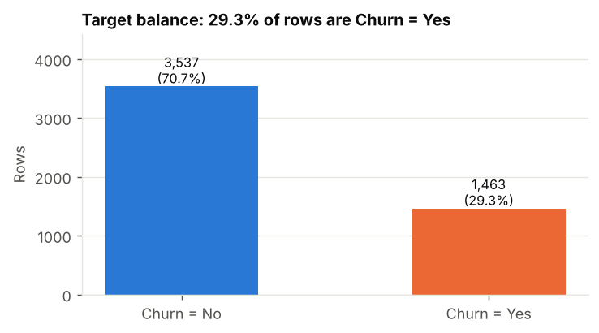
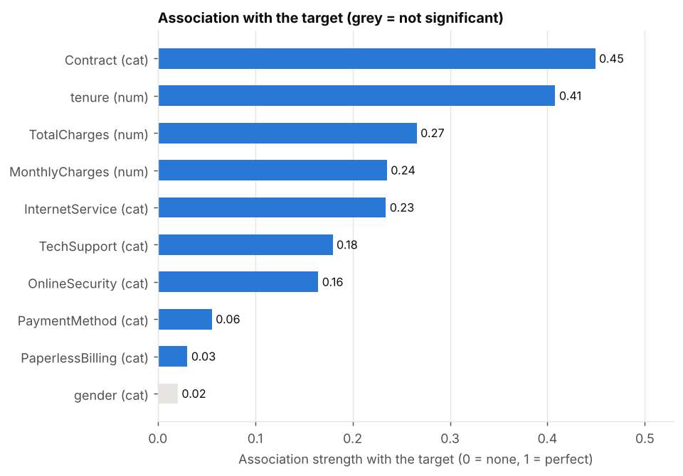
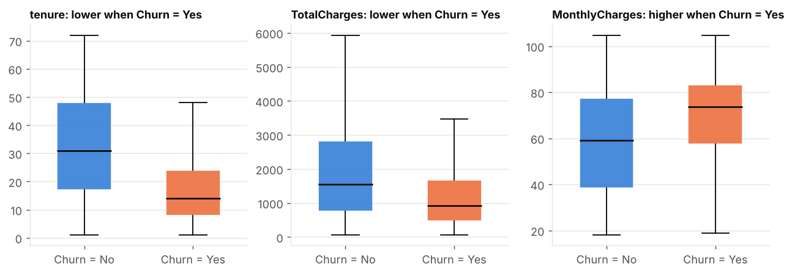
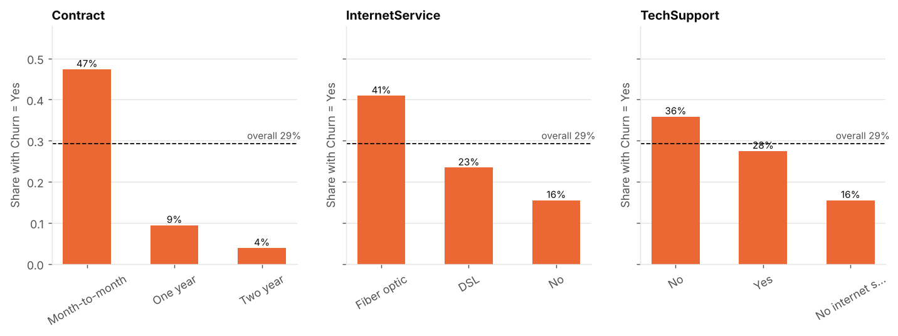
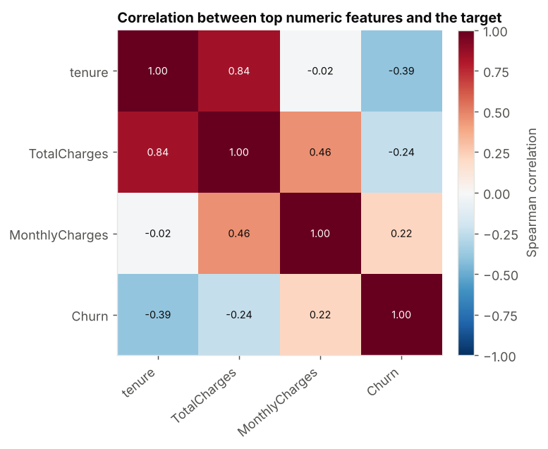
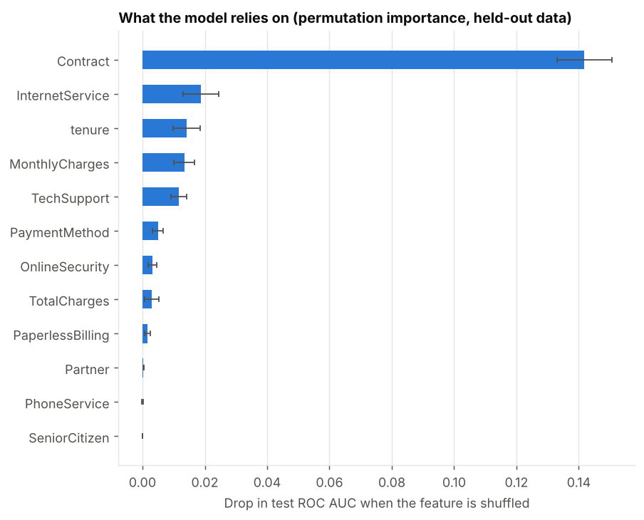
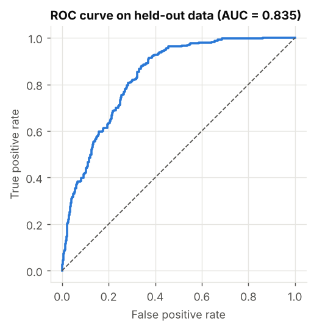

# Automated Data Analysis Report

> **Question:** Find the driving factors behind customer churn  
> **Target:** `Churn` (classification) &nbsp;|&nbsp; **Rows analysed:** 5,000 &nbsp;|&nbsp; **Generated:** 2026-10-10 08:13 UTC &nbsp;|&nbsp; **Engine:** offline:templates

## Executive summary
- Across 5,000 analysed rows, 29.3% have **Churn = Yes**.
- The strongest statistically significant drivers are **Contract** (medium association, strength 0.45), **tenure** (medium association, strength 0.41), **TotalCharges** (small association, strength 0.27).
- Contract: 'Month-to-month' has the highest Churn rate (47.4%, n=2788) vs 'Two year' at 3.9% (n=1206); overall rate 29.3%.
- A logistic regression model separates the outcome on unseen data with ROC AUC 0.83; the highest-scored 10% of rows contain 26% of all positives (2.6x lift over random selection).
- These are statistical associations in observational data, not proof of cause and effect.

## Data quality & preparation
- Started with 5,040 rows and 17 columns; kept 5,000 rows and 15 columns after cleaning.
- Removed 40 exact duplicate rows so no record is counted twice.
- Dropped 2 columns that cannot carry signal: customerID (identifier / excluded by the plan), Country (constant column).
- Converted text columns that actually hold numbers: TotalCharges.
- Filled missing values in 3 columns using the median (numbers) or most common value (categories); most affected: MonthlyCharges (1.98% missing), PaymentMethod (1.50% missing), TotalCharges (0.04% missing).
- Clipped extreme values in tenure, MonthlyCharges, TotalCharges to the 0.5-99.5 percentile range so entry errors cannot distort the results.

## What drives the outcome
Features are ranked by association strength (0 = none, 1 = perfect); significance is after Benjamini-Hochberg correction for testing many features.
1. **Contract** - strength 0.45 (medium, significant). Contract: 'Month-to-month' has the highest Churn rate (47.4%, n=2788) vs 'Two year' at 3.9% (n=1206); overall rate 29.3%.
2. **tenure** - strength 0.41 (medium, significant). tenure is lower when Churn = Yes (median 14.00 vs 31.00; Cohen's d = -0.89).
3. **TotalCharges** - strength 0.27 (small, significant). TotalCharges is lower when Churn = Yes (median 925.27 vs 1555.72; Cohen's d = -0.55).
4. **MonthlyCharges** - strength 0.24 (small, significant). MonthlyCharges is higher when Churn = Yes (median 73.62 vs 59.17; Cohen's d = 0.48).
5. **InternetService** - strength 0.23 (small, significant). InternetService: 'Fiber optic' has the highest Churn rate (40.9%, n=2174) vs 'No' at 15.5% (n=1128); overall rate 29.3%.
6. **TechSupport** - strength 0.18 (small, significant). TechSupport: 'No' has the highest Churn rate (35.9%, n=2665) vs 'No internet service' at 15.5% (n=1128); overall rate 29.3%.
- Note: **tenure** and **TotalCharges** move together (rank correlation 0.84); their individual effects overlap.

## Predictive model
- Three candidates were compared with 5-fold cross-validation on the training split (ROC AUC): baseline (majority class) 0.50, logistic regression 0.84, gradient boosting 0.83. The best, **logistic regression**, was evaluated once on a held-out 20% test set.
- Test performance: ROC AUC 0.83, precision 0.54, recall 0.78, F1 0.64 at a decision threshold of 0.30 (chosen on training data only).
- Always predicting the majority class would be right 71% of the time but would find none of the positives; the model's recall of 0.78 is what makes it useful.
- What the model relies on most (permutation importance on held-out data): Contract, InternetService, tenure, MonthlyCharges, TechSupport.

## Recommendations
1. Prioritise the highest-rate segments first: Contract = 'Month-to-month' (47.4% vs 29.3% overall); InternetService = 'Fiber optic' (40.9% vs 29.3% overall).
2. Investigate why **tenure** separates the groups (it is lower for the positive class) and whether it can be influenced.
3. Use the model's risk score to rank cases and act on the top decile first, where it captures 26% of positives.
4. Validate the top drivers with a controlled experiment before committing budget - these results show association, not causation.

## Limitations & next steps
- The target column **Churn** was inferred from your question; if that is not what you meant, run again with the target column set explicitly.
- Observational data: drivers are associations, and hidden confounders may explain part of them.
- Models were validated on a single random split; for time-dependent data use a time-based split before deploying.
- Missing values were imputed and extreme values clipped; both are logged in Appendix A and can change effect sizes slightly.
- Next steps: add domain features, test a time-based validation, and monitor drift after deployment.

## Charts

**Target distribution**

**Strength of association with the target**

**Top numeric drivers**

**Top categorical drivers**

**Correlation between top numeric features**

**What the model relies on**

**Model discrimination (ROC curve)**

## Appendix A - Data cleaning log

| Step | What was done | Rows/cells/columns affected |
|---|---|---|
| placeholder_to_missing | Converted blank / 'N/A' / '?' style placeholders to missing values | 2 |
| drop_duplicates | Removed exact duplicate rows | 40 |
| coerce_numeric | Converted text columns that are really numbers | 1 |
| drop_columns | Dropped columns that carry no usable signal | 2 |
| encode_target | Encoded target as 1 = 'Yes', 0 = other | 5000 |
| winsorise_outliers | Clipped extreme values to the 0.5-99.5 percentile range | 77 |
| impute_missing | Filled remaining missing values | 176 |

## Appendix B - Statistical tests (top 15 by strength)

| Feature | Type | Test | Strength (0-1) | Size | Adj. p-value | Significant |
|---|---|---|---|---|---|---|
| Contract | categorical | chi-square | 0.449 | medium | 1.8e-218 | yes |
| tenure | numeric | Mann-Whitney U | 0.408 | medium | 2.7e-168 | yes |
| TotalCharges | numeric | Mann-Whitney U | 0.266 | small | 6.8e-64 | yes |
| MonthlyCharges | numeric | Mann-Whitney U | 0.235 | small | 2.6e-52 | yes |
| InternetService | categorical | chi-square | 0.234 | small | 1.1e-59 | yes |
| TechSupport | categorical | chi-square | 0.179 | small | 2.5e-35 | yes |
| OnlineSecurity | categorical | chi-square | 0.165 | small | 7.4e-30 | yes |
| PaymentMethod | categorical | chi-square | 0.055 | negligible | 0.0027 | yes |
| PaperlessBilling | categorical | chi-square | 0.030 | negligible | 0.049 | yes |
| gender | categorical | chi-square | 0.021 | negligible | 0.2 | no |
| Partner | categorical | chi-square | 0.011 | negligible | 0.57 | no |
| SeniorCitizen | categorical | chi-square | 0.006 | negligible | 0.77 | no |
| Dependents | categorical | chi-square | 0.004 | negligible | 0.83 | no |
| PhoneService | categorical | chi-square | 0.003 | negligible | 0.84 | no |

## Appendix C - Model evaluation

| Candidate | CV roc_auc (mean) | CV std |
|---|---|---|
| baseline (majority class) | 0.5000 | 0.0000 |
| logistic regression | 0.8408 | 0.0138 |
| gradient boosting | 0.8285 | 0.0137 |

| Held-out test metric | Value |
|---|---|
| model | logistic regression |
| n_train | 4000 |
| n_test | 1000 |
| cv_folds | 5 |
| cv_metric | roc_auc |
| threshold | 0.3034 |
| roc_auc | 0.8349 |
| pr_auc | 0.6420 |
| accuracy | 0.7420 |
| precision | 0.5414 |
| recall | 0.7816 |
| f1 | 0.6397 |
| brier | 0.1485 |
| positive_rate_test | 0.2930 |
| baseline_accuracy | 0.7070 |
| lift_top_decile | 2.5597 |
| capture_top_decile | 0.2560 |

## Appendix D - Reproducibility & verification

| Item | Value |
|---|---|
| Run id | 20261010-081331-1c2be2 |
| AutoInsight version | 0.1.0 |
| LLM / engine | offline:templates |
| Code execution sandbox | local |
| Attempts (engineer / analyst) | 1 / 1 |
| Deterministic fallback used | none |
| Numbers in narrative traced to computed results | 71 of 71 (100%) |
| Random seed | 42 |
| Python | 3.13.16 |

_Every figure in the narrative was checked against the computed results; the code each agent ran is stored in `logs/` next to this report._
